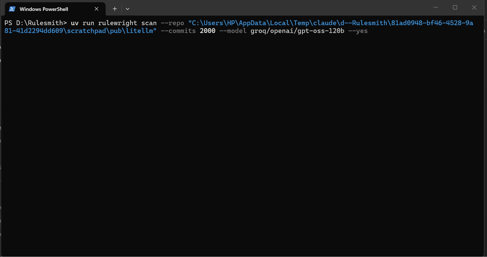

# rulewright

**Your coding agent learns from its mistakes, provably, and safely.**

rulewright reads your repo's git history (and Claude Code session logs), finds the mistakes
coding agents keep repeating, and proposes evidence-backed rules for `AGENTS.md`,
`CLAUDE.md`, `.cursorrules` and Copilot instructions. Every rule cites at least 3 commits or
messages. No rule or agent file is written until you approve it. (`scan` only leaves its own
report, `rulewright-report.md`, and a cache folder, `.rulewright/`, in the repository; add both to
your `.gitignore`.)

> **Status: v0.1, early.** It has been run on a handful of public repositories. It works best
> on repos where a lot of agent-written commits get fixed by a person soon after (on litellm,
> about 3 of 5 proposed rules were good, the rest weak). On repos with little of that it says
> so and proposes nothing. Treat every proposal as a shortlist to review, not a list to accept.
> `prove` and `guard` are newer still: `prove` needs Docker and shows evidence, not proof.



## Install

```
pipx install rulewright
```

Python 3.11+. The first run downloads a small embedding model (about 90 MB).

## Use

```
rulewright scan            # read the last 500 commits, print proposed rules, change nothing
rulewright apply r-3e6f373f r-5f86d161    # accept chosen rules, write rulewright.yaml and agent files
rulewright emit --dry-run  # preview re-rendering every agent file from rulewright.yaml
rulewright stale           # rules that mention paths or commands that no longer exist
rulewright prove r-3e6f373f  # replay past tasks with and without the rule (needs Docker)
rulewright guard           # propose a permission allowlist from the commands agents ran
rulewright guard --diff    # show the change to .claude/settings.json, write nothing
rulewright guard --apply   # write it after you confirm
```

Mining and clustering run locally with no API key. Only the last step, writing the rule text,
calls an LLM: a local Ollama model if one is running, otherwise your own `GROQ_API_KEY`,
`ANTHROPIC_API_KEY` or `OPENAI_API_KEY` (or pick one with `--model`, any LiteLLM name such as
`groq/openai/gpt-oss-120b`). The estimated cost is shown, and you are asked, before any paid call.

## What a result looks like

This is real output on a small demo repo with planted mistakes (not a public repo), using a local
`qwen2.5-coder:7b`:

```
Read 45 commits (15 agent-authored); 15 signal(s) [refix] in 3 cluster(s).
 id          proposed rule                                      scope         evidence
 r-5f86d161  Do not skip failing pytest tests; fix them instead. tests/*.py    e0d279a, b4b4120, 4365f63 +2
```

`rulewright-report.md` lists the evidence behind each rule as commit links.

**Rule quality depends on the model.** On busy real repositories a small local model (7B) wrote
generic rules from good clusters. A second check asks the model whether each rule is specific or
generic advice and drops the generic ones (`--no-judge` skips it), but judge every rule by its
evidence, and for real repos use a stronger model, for example
`rulewright scan --model groq/openai/gpt-oss-120b` with your own key (the cost is shown first).

## How it stays safe

rulewright writes text that agents will obey, so everything it mines is treated as hostile.

- Mined text reaches the LLM only inside a delimited data block (random tag), and the reply must
  match a fixed schema.
- Proposed rules are scanned for URLs, curl/wget, credentials, env files, new shell commands and
  disabling tests or permissions. Flagged rules are shown in red and never pre-selected.
- A rule needs 3+ pieces of evidence, and each cited commit must exist in your repo.
- Likely secrets are redacted before any API call.
- No rule or agent file is written without `apply` (or a pull request you review). Only the content between
  `<!-- rulewright:start -->` and `<!-- rulewright:end -->` is ever edited.

See [SECURITY.md](SECURITY.md).

## Roadmap

- **v0.1** `scan`, `apply`, `emit`, `stale`: this release.
- **v0.2** `prove` (implemented, pre-release): replay past tasks in a Docker sandbox (no network,
  no secrets) with and without a rule and report how often the mistake recurs. Results are
  evidence, not statistical proof: a handful of tasks, nondeterministic agents, and prompts rebuilt
  from commit messages. The built-in agent is simple; its runs are only as good as the model.
- **v0.3** `guard` (implemented, pre-release): reads the shell commands your agents ran (Claude
  Code and Codex logs) and proposes `permissions.allow` rules for Claude Code, but only for a
  short built-in list of read-only, test, lint and build commands. Everything else it sees is
  shown for you to judge, and risky commands (`rm`, `curl`, `git push`, interpreters, `docker`) are
  never offered. It runs no LLM and executes nothing.

How it works and why each choice was made: [docs/ARCHITECTURE.md](docs/ARCHITECTURE.md),
[docs/DECISIONS.md](docs/DECISIONS.md).
